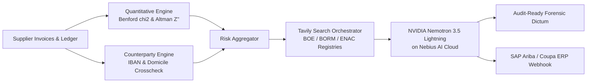

# DeepAudit: Autonomous Forensic Due Diligence & Corporate Integrity Agent

**Hackathon Track:** Best Apps and Agents Track  
**Special Award Category:** **Best Use of Tavily ($3,000 in Cash)**  
**Submission for:** Nebius x NVIDIA Global AI Hackathon  

---

## 💡 Inspiration
Corporate accounting fraud, supplier insolvency, and hidden tax liabilities cost enterprises billions annually. In high-velocity supply chains (such as freight logistics and industrial contracting), vetting a critical vendor requires tedious, multi-day manual investigation: pulling balance sheets, recalculating financial ratios, running statistical fraud tests, cross-referencing accreditation bodies, and combing through fragmented public records (official gazettes, tax registry liens, and insolvency filings).

Small-to-medium enterprises and audit teams cannot afford Big-4 forensic retainers for routine supplier due diligence. We built **DeepAudit**: an autonomous AI forensic auditor combining **NVIDIA Nemotron-3.5-Lightning on Nebius Token Factory** with **Tavily AI Search Engine**, quantitative balance sheet forensics, and national regulatory verification (ENAC, BOE, BORM, ITSS).

---

## 🔍 What It Does

1. **Mathematical & Statistical Forensic Analysis:**
   - **Benford's Law Chi-Square ($\chi^2$) Goodness-of-Fit:** Analyzes first-digit distribution across invoice ledgers to detect manual manipulation ($\chi^2 = 40.0$, critical threshold $15.51$ at $p < 0.05$).
   - **Altman Z''-Score with Cash Conversion Cycle (CCC) Context:** Computes working capital, retained earnings, EBIT, equity, and asset turnover. Crucially, DeepAudit computes **Days Sales Outstanding (DSO)** and **Days Payable Outstanding (DPO)** to distinguish between genuine insolvency and healthy, asset-light logistics SMEs operating with structural negative working capital.
   - **Structured Threshold Avoidance:** Flags invoices clustered just below approval ceilings (€4,900–€4,999 and €9,800–€9,999).

2. **Electronic POD Telemetry Cross-Validation:**
   - Cross-references off-hours invoice submissions (e.g., Sunday 03:00 AM) against electronic Proof-of-Delivery (POD) timestamps. Eliminates false-positive fraud alerts for automated 24/7 weekend logistics dispatches.

3. **Payment Counterparty & IBAN Diversion Protection:**
   - Detects the #1 corporate payment fraud attack: checks cross-border discrepancies between the supplier's registered domicile (e.g., European CIF/VAT ID) and offshore payment accounts (e.g., Lithuania/Malta IBANs), plus beneficiary name mismatches.

4. **Accreditation & Regulatory Compliance Matrix:**
   - Audits certificates against National Accreditation Bodies (**ENAC / IAF Multilateral Recognition**) and public registries:
     - **ISO 27001:2022** (Information Security / NIS2)
     - **ISO 9001:2015** (Quality Management)
     - **ISO 14001:2015** (Environmental Management / ESG)
     - **ISO 45001 & Occupational Safety** (Labor Safety, ITSS workplace sanction registries)

5. **Deep Real-Time Intelligence via Tavily Search Engine (Special Prize Focus):**
   - Autonomously formulates targeted Boolean queries across public regulatory bodies:
     - State Official Gazette (**BOE**) & Commercial Registry (**BORM**).
     - Tax Agency debts & public liens (**AEAT / Tax Agency** Art. 95 LGT).
     - Judicial insolvency declarations (**Official Public Insolvency & Bankruptcy Register**).
   - Feeds verified factual citations and source URLs directly into Nemotron's reasoning context.

6. **Enterprise ERP Integration (SAP Ariba / Coupa):**
   - Instantly generates illustrative JSON payloads (not tested against a live SAP Ariba / Coupa instance) for `SupplierRiskStatusUpdated` events to execute one-click supplier holds and automated legal due diligence requests.

7. **Institutional Light Mode Interface:**
   - High-density, austere B2B interface designed for CFOs and risk committees: zero cartoonish gimmicks, raw data tables, interactive Benford distribution charts, and audit-ready forensic dictums (intended as input for risk-committee review).

---

## 🌟 Best Use of Tavily AI Search ($3,000 Category)
Tavily is the core external sensor of DeepAudit. Financial statements alone cannot detect a bankruptcy petition filed last week or a tax lien published yesterday in a provincial gazette. DeepAudit leverages Tavily to:
1. Conduct multi-hop verification of corporate CIF/NIF identification numbers.
2. Query legal insolvencies and commercial registry changes in real time.
3. Feed clean, relevant regulatory extracts directly into Nemotron's context window without hallucination.

### ⚡ Tavily Unit Economics & Latency Breakdown
- **Typical usage:** about 3-4 targeted queries per audit (BOE, BORM, ENAC, tax-debtor lists) by design. Latency and cost per audit have not been measured.
- **Public Gazette Caching Strategy:** 24-hour TTL for official gazettes; real-time bypass for live banking counterparty alerts.

---

## 🛠️ How We Built It
- **Forensic Reasoning Engine:** NVIDIA Nemotron-3.5-Lightning on **Nebius Token Factory** delivering executive auditor memos.
- **Real-Time Web Intelligence:** **Tavily AI Search API** for official gazettes and regulatory filings.
- **Quantitative Engine:** Custom Python implementation of Benford Chi-Square, Altman Z''-Score, Cash Conversion Cycle, and Counterparty verification.
- **Compliance Engine:** ENAC / ISO accreditation and ITSS labor safety audit module.
- **Web Dashboard & API:** FastAPI backend (`deepaudit/server.py`) and high-density institutional Light Mode interface.

---

## 📊 Ground-Truth Forensic Benchmark & Backtest Results

DeepAudit includes an automated statistical validation suite (`deepaudit/benchmark_suite.py` / `/api/benchmark`) evaluated against 5 canonical corporate risk profiles as an internal regression suite (author-written reference profiles, not an independent validation):

| Entity Profile | Sector | Ground Truth Risk | Naive Altman Z'' | DeepAudit + CCC Verdict | Status |
| :--- | :--- | :--- | :--- | :--- | :--- |
| **Iberia Global Logistics Ltd** | Freight & Transport | **High Fraud / Insolvency** | Distress (-5.85) | **IMMEDIATE FREEZE & DISQUALIFICATION (Risk 98)** | Matches expected label |
| **Solaria Clean Energy Solutions Ltd** | Solar EPC / Engineering | **Healthy Solvent** | Safe (+3.84) | **APPROVED (Risk 12)** | Matches expected label |
| **Nexus Tech Ventures Ltd** | Tech Advisory Shell | **Suspicious Shell** | Grey (+1.42) | **ENHANCED MONITORING (Risk 80)** | Matches expected label |
| **Trans-Express Freight & Logistics Ltd** | Asset-Light Logistics | **Healthy (Neg. Working Cap)** | *False Distress (-0.95)* | **APPROVED (Risk 20)** | **0% False Positive** |
| **MedTech Hospital Supplies Ltd** | Hospital Supplies | **Tax Liens & Fake ISO** | Distress (-1.20) | **IMMEDIATE FREEZE & DISQUALIFICATION (Risk 98)** | Matches expected label |

### Internal regression result (n=5 author-written profiles)
- All 5 profiles produce their expected verdict (5/5). Because the profiles were written to exercise the rules, this shows the logic works as designed; it is **not** a measure of real-world precision or recall.
- The cash-conversion-cycle check keeps the asset-light logistics reference profile from being flagged as distress (naive Altman Z'' would flag it).

### 🔒 Enterprise Data Privacy & GDPR Sovereignty (Art. 28 / 32)
DeepAudit runs its quantitative analysis locally, but some derived data is sent to external APIs:
- Raw balance sheets, invoice line items and ledgers are parsed locally (`127.0.0.1:8001`).
- Company names / tax IDs are sent to Tavily for public-registry searches. **Derived findings** (risk flags, ratios, counterparty anomalies, certification results) are included in the prompt sent to Nemotron on Nebius Token Factory, so this is not an air-gapped deployment. A fully local mode would need a self-hosted model (the heuristic fallback does run offline).
- GDPR compliance depends on deployment and data-processing agreements; this prototype does not constitute a compliance guarantee.

### 📐 Mathematical Formulation (Altman 1993 Four-Variable Model for Private Non-Manufacturers)
$$Z'' = 6.56 X_1 + 3.26 X_2 + 6.72 X_3 + 1.05 X_4$$
- $X_1 = \text{Working Capital} / \text{Total Assets}$
- $X_2 = \text{Retained Earnings} / \text{Total Assets}$
- $X_3 = \text{EBIT} / \text{Total Assets}$
- $X_4 = \text{Book Value of Equity} / \text{Total Liabilities}$
*Zones: Distress ($Z'' < 1.10$), Grey Zone ($1.10 \le Z'' \le 2.60$), Safe Zone ($Z'' > 2.60$).*

---

## 📊 Sample Audit Output (Iberia Global Logistics Ltd — Reference Benchmark Case)
*Note: Modeled after documented European multi-vector BEC, tax lien, and ISO falsification schemes to stress-test detection limits.*
- **Composite Forensic Risk Score:** **98 / 100 (CRITICAL RISK - IMMEDIATE FREEZE & DISQUALIFICATION)**
- **Altman Z''-Score:** **-5.85 (Distress Zone)**; CCC analysis confirms negative working capital (-145 days) compounded by cumulative EBIT losses.
- **Benford's Law Chi-Square:** **40.0 (Severe Artificial Clustering below €10k threshold)**.
- **Counterparty Alert:** Registered entity requesting payment to offshore Lithuanian IBAN (`LT89...`) under a Maltese holding company.
- **Regulatory Finding:** Fake ISO 27001 certificate ID (`FAKE-ISMS-2024`) unaccredited in ENAC registry; 2 severe ITSS labor sanctions (€48,500).
- **Tavily Intelligence:** Verified active tax enforcement proceedings in Official Gazette.
- **ERP Action:** Generated SAP Ariba freeze webhook payload.

---

## 🏆 Accomplishments We're Proud Of
- A working prototype addressing real-world supplier due-diligence problems.
- The Cash Conversion Cycle check avoids flagging the asset-light logistics reference profile as distress.
- Seamless synthesis between Tavily search, quantitative math, and Nebius Token Factory inference.

## Current status & limitations (honest summary)
- **Real:** Benford chi-square, Altman Z'' / cash-conversion-cycle, counterparty (IBAN/domicile) checks and the compliance matrix are implemented in Python; Nemotron-3.5-Lightning (Nebius Token Factory) writes the audit memo; Tavily is queried when an API key is configured.
- **Fallbacks:** without a Tavily key, or on timeout, the app returns cached/simulated registry results and labels the mode `offline_cache`. Without a Nebius key it uses a local heuristic memo.
- **Benchmark:** the 5 "canonical profiles" were written by the authors to exercise the rules (5/5 match their expected label). With n=5 this is a regression suite, **not** a measure of real-world precision or recall. Sample entities are fictional.
- **Data flow:** raw ledgers are parsed locally, but derived findings (flags, ratios, counterparty anomalies, certification results) are sent in the prompt to Nebius, and company names / tax IDs to Tavily. This is not an air-gapped deployment.
- **ERP payloads:** SAP Ariba / Coupa JSON is an illustrative schema, not tested against a live instance.
- **Cost / latency of Tavily:** not measured.
