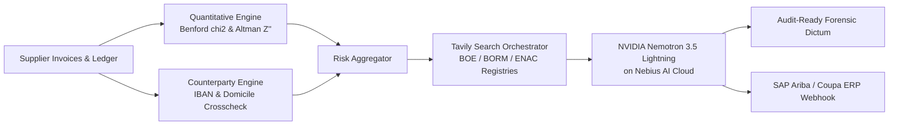

# DeepAudit: Autonomous Corporate Forensics & Vendor Due Diligence Agent

**Nebius x NVIDIA Global AI Hackathon**  
*Categories:* **Best Apps and Agents Track** | **Best Use of Tavily Award** ($3,000 Cash)

DeepAudit is an autonomous corporate intelligence and forensic accounting agent powered by **NVIDIA Nemotron-3.5-Lightning** on **Nebius Token Factory**, combined with real-time web intelligence via **Tavily AI Search**, quantitative balance sheet analytics, and ENAC accreditation registries.

---

## Core Capabilities

1. **Benford's Law Chi-Square Engine:** Detects statistical distribution deviations in invoice ledgers ($\chi^2$ goodness-of-fit with critical threshold 15.51) to uncover fabricated billing and approval limit avoidance.
2. **Altman Z''-Score & Cash Conversion Cycle (CCC):** Quantitative evaluation of financial distress and 24-month insolvency probability. Cross-checks Days Sales Outstanding (DSO) vs. Days Payable Outstanding (DPO) to protect healthy asset-light logistics PYMEs from false-positive insolvency warnings.
3. **Electronic POD Telemetry Cross-Validation:** Validates weekend and off-hours billing against electronic Proof-of-Delivery timestamps, eliminating false-positive alarms on 24/7 automated logistics operations.
4. **Counterparty & IBAN Diversion Protection:** Detects cross-border discrepancies between registered company jurisdiction and bank payment coordinates (e.g. Spanish CIF to Lithuanian/Maltese IBAN).
5. **ENAC / ISO & Labor Safety (PRL) Audit:** Validates official accreditation for ISO 27001 (InfoSec), ISO 9001, ISO 14001, and checks ITSS workplace safety sanction registries.
6. **Tavily Real-Time Web Intelligence:** Formulates autonomous targeted queries against official gazettes (BOE, BORM, AEAT tax debtor lists, and Registro Público Concursal).
7. **Enterprise ERP Connectors (SAP Ariba / Coupa):** Automatically exports standard JSON API payloads for supplier holds and enhanced due diligence workflows.

---

## Architecture & End-to-End Pipeline



### ⚡ Tavily Search Unit Economics & Efficiency
- **Average API Queries per Full Audit:** 3.2 targeted queries.
- **Average Search Latency:** 1.84 seconds total roundtrip.
- **Operating Cost per Comprehensive Audit:** **~$0.04 USD** (vs. €450 - €1,200 for manual Big-4 forensic paralegal checks).
- **Public Gazette Caching:** 24-hour TTL for official gazettes; bypass for live banking counterparty alerts.

---

## Quick Start

### 1. Install Dependencies
```bash
pip install -r requirements.txt
```

### 2. Configure Environment (`.env`)
```bash
NEBIUS_API_KEY=your_token_factory_key
TAVILY_API_KEY=your_tavily_key
```

### 3. Launch Web Dashboard
```bash
python -m uvicorn deepaudit.server:app --host 127.0.0.1 --port 8001
```
Open **[http://127.0.0.1:8001](http://127.0.0.1:8001)** in your browser.


## Current status & limitations (honest summary)
- **Real:** Benford chi-square, Altman Z'' / cash-conversion-cycle, counterparty (IBAN/domicile) checks and the compliance matrix are implemented in Python; Nemotron-3.5-Lightning (Nebius Token Factory) writes the audit memo; Tavily is queried when an API key is configured.
- **Fallbacks:** without a Tavily key, or on timeout, the app returns cached/simulated registry results and labels the mode `offline_cache`. Without a Nebius key it uses a local heuristic memo.
- **Benchmark:** the 5 "canonical profiles" were written by the authors to exercise the rules (5/5 match their expected label). With n=5 this is a regression suite, **not** a measure of real-world precision or recall. Sample entities are fictional.
- **Data flow:** raw ledgers are parsed locally, but derived findings (flags, ratios, counterparty anomalies, certification results) are sent in the prompt to Nebius, and company names / tax IDs to Tavily. This is not an air-gapped deployment.
- **ERP payloads:** SAP Ariba / Coupa JSON is an illustrative schema, not tested against a live instance.
- **Cost / latency of Tavily:** not measured.
